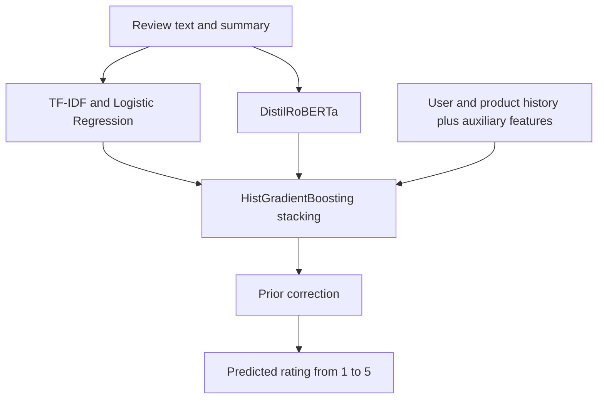

# Accident Anticipation and Amazon Review Analysis

**QBC13 AI Bootcamp · Group 4 · Project 2**

This project explores how input representation and model architecture influence prediction in two domains: anticipating accidents from dashcam videos and analyzing customer reviews of electronics products on Amazon.

The work follows a sequence of decisions: understand the data, preserve useful evidence in the input, choose a suitable model, and measure the resulting behavior.

**[Interactive dashboard](dashboard.html)** · **[Project presentation](AI_Bootcamp_Group4_Presentation_EN.pdf)** · **[Project brief](https://docs.google.com/document/d/13svIffMnZpzdDUqRERQIR3cJHNZK6APT9zRLm3q5-XA/edit)**

## Project Overview

| Task | Objective | Approaches |
| --- | --- | --- |
| Accident anticipation | Estimate accident probability from video observed before an event | MViT V2-S and ResNet18 + Bi-GRU with temporal attention |
| Review exploration | Understand ratings, text, reviewers, products, and brands | Data cleaning, descriptive statistics, and visual analysis |
| Warranty analysis | Extract warranty-related reviews and aggregate their ratings by product | Word2Vec, GloVe comparison, spelling expansion, and contextual filtering |
| Rating prediction | Predict a review's rating from 1 to 5 | MiniBERT experiments, DistilRoBERTa, TF-IDF, history features, and stacking |

## 1. Accident Anticipation

### Prediction setup

The Nexar dataset contains **1,500 labeled videos**, evenly divided between accident and normal driving, and **1,344 test videos**. We construct observation windows of up to 10 seconds ending **0.5, 1.0, or 1.5 seconds before the event**.

Videos are split into **1,200 training videos and 300 validation videos** before clip construction. Negative-clip timing is estimated from positive videos in the training split.

The two approaches use their own temporal policies:

- **MViT:** for horizons above 0.5 seconds, retain clips whose alert-to-event lead exceeds the horizon.
- **Bi-GRU:** retain clips at all three horizons and use the alert time to determine whether an accident-source clip receives a positive label.

### Input and architecture decisions

| Decision | MViT V2-S | ResNet18 + Bi-GRU |
| --- | --- | --- |
| Frame input | 16 uniformly sampled RGB frames at 224 × 224 | 24 uniformly sampled RGB frames at 128 × 224 |
| Reason for this representation | Cover the temporal window with a fixed tensor for a video backbone | Preserve a 16:9 view and an ordered sequence for temporal modeling |
| Normalization | Kinetics-400 statistics, matching the pretrained video weights | ImageNet statistics, matching the pretrained ResNet18 encoder |
| Appearance augmentation | Preprocessing defined in the MViT notebook | Shared brightness and contrast changes across each training clip |
| Architecture choice | Multiscale attention models spatial and temporal relationships jointly | A CNN extracts frame features, then Bi-GRU models their sequence |
| Training strategy | Train the final transformer block, normalization, and binary head | Freeze ResNet18 and train Bi-GRU, temporal attention, and classifier |
| Computational design | Adapt 7.10M of 34.23M parameters | Cache a 24 × 512 feature sequence per clip and train a 2.50M-parameter temporal model |

Caching makes repeated sequence experiments practical: the recorded Bi-GRU training time is **less than one second per epoch after feature extraction**. Temporal attention learns how strongly to weight the observed frames.

### Recorded validation results

| Pipeline | AP at 0.5 s | AP at 1.0 s | AP at 1.5 s | Mean AP |
| --- | ---: | ---: | ---: | ---: |
| MViT V2-S | 0.7232 | 0.6911 | 0.6737 | **0.6960** |
| ResNet18 + Bi-GRU + Attention | 0.7541 | 0.6092 | 0.4914 | **0.61823** |

Each row reports the selected checkpoint on that pipeline's validation clips: **657 clips for MViT** and **900 for Bi-GRU**. Mean AP averages the three prediction horizons.

For test inference, MViT takes the maximum probability across three clips per video. The ResNet18 + Bi-GRU pipeline uses the final 10-second window. Both produce video-level submission files.

**Notebooks:** [MViT V2-S](problem1/ai-g4-q1-mvit.ipynb) · [ResNet18 + Bi-GRU](problem1/ai-g4-q1-up.ipynb)

**Reports:** [MViT V2-S](problem1/MViT%20V2-S.pdf) · [ResNet18 + Bi-GRU](problem1/ResNet18%20%D9%88%20Bi-GRU.pdf)

## 2. Amazon Review Exploration and Warranty Analysis

### Understanding the data

The review dataset starts with **838,944 labeled reviews**. Removing **8,554 duplicates** by reviewer, product, and review text leaves **830,390 reviews** for exploratory analysis. We join product titles and brands, decode HTML entities, and convert helpful-vote counts to numeric values.

The analysis covers rating distributions, sentiment word clouds, helpful reviewers, text length, five-star product counts, and mean ratings of high-volume brands.

Several observations informed subsequent decisions:

- About **55% of reviews are five-star**, motivating investigation of the rating prior.
- Median review length is **409 characters**, with a 95th percentile around **1,700 characters**, motivating careful handling of long text.
- Frequent-word clouds share vocabulary across sentiment groups. Distinctive-word analysis highlights **warranty**, which appears **4.2 times as frequently in negative reviews relative to other groups**.

### Extracting warranty-related reviews

We expand an initial `warranty` / `guarantee` search using **Word2Vec trained on the review corpus**, compare its neighbors with **GloVe**, and use `difflib` to capture additional spelling variants. Contextual rules filter non-warranty uses of words such as `guarantee`. The term `rma` extends retrieval to a product-return expression used in this domain.

| Recorded outcome | Value |
| --- | ---: |
| Warranty-related reviews | **18,637** |
| Mean rating of warranty-related reviews | **3.08** |
| Mean rating across all cleaned reviews | **4.02** |
| Products with at least five warranty-related reviews | **625** |
| Share of those products below their overall rating | **82%** |
| Mean product-level rating gap | **0.83 stars** |

The initial filter returned **49 relevant reviews out of 50 manually checked results**, equivalent to **98% sample precision**. The later `rma` extension received a separate manual inspection.

**Notebook:** [Exploration and warranty analysis](problem2/q2_part1_part2.ipynb)

**Output:** [Product-level warranty ratings](problem2/outputs/warranty_by_product.csv)

## 3. Predicting Ratings from 1 to 5

### MiniBERT as the experimental model

We first used **MiniBERT** to test input and feature decisions efficiently on a T4 GPU. The backbone, `google/bert_uncased_L-4_H-256_A-4`, has four transformer layers, a hidden size of 256, four attention heads per layer, and approximately 11.17M parameters. A five-class head is fine-tuned with the backbone.

The experiment series uses a stratified 50% sample of **419,472 reviews**, split **70% / 15% / 15%** into training, validation, and internal test sets with seed 42.

| Version | Input or feature decision | Reason | Validation Micro-F1 |
| --- | --- | --- | ---: |
| V1 | Review text, up to 128 tokens, with dynamic padding | Establish a compact pretrained baseline | 70.539% |
| V2 | Increase to 256 tokens. For long reviews, introduce the summary and retain the first 192 and last 64 tokens. Increase training batch size to 128. | Preserve introductory and concluding sentiment while using the input budget efficiently | 72.191% |
| V3 | Test conservative removal from a predefined function-word set, protecting sentiment-sensitive expressions | Examine whether lexical filtering saves useful token space | 71.814% |
| V4 | Use the V2 text policy and add the mean and count of earlier user ratings | Supply information about the user's previous rating behavior | **72.203%** |

V2's combined configuration improves validation Micro-F1 by **1.651 percentage points** over V1 and changes MAE from **0.4122 to 0.3701**. V3 records **4.21% fewer model-input tokens** and allows **1,577 additional training reviews** to fit without truncation.

For V4, user history uses eligible training observations from days **strictly before** the target review. A learned gate blends text and history probability distributions with a **20% maximum history weight** and a text-only fallback when history is absent.

The saved V4 checkpoint achieves **72.057% Micro-F1** and **0.368049 MAE** on its **62,921-review internal test set**, without additional training.

**Experiments and report:** [MiniBERT directory](problem2/Mini-Bert/) · [Experimental report](problem2/Mini-Bert/Project%20Report.pdf)

### Final contextual model and fusion

After the lightweight experiments, the final modeling stage develops the same feature direction: useful review text, summaries, and user context. The executed contextual backbone is **DistilRoBERTa**, with model identifier `distilbert/distilroberta-base`.

The final system combines complementary evidence:

- **TF-IDF + Logistic Regression** supplies word and phrase evidence.
- **DistilRoBERTa** supplies contextual probabilities for the five ratings.
- **Stacking C** learns how to combine model probabilities with user, product, and auxiliary features using `HistGradientBoostingClassifier`.
- **Prior correction** adjusts output probabilities using the training rating distribution. BBSE estimates a near-balanced test prior, and the selected correction uses `alpha = 1`.

### Final modeling results

| Model | Natural validation, without prior correction | Balanced validation, with prior correction |
| --- | ---: | ---: |
| TF-IDF + Logistic Regression | 70.76% | 57.61% |
| DistilRoBERTa | 76.97% | 66.26% |
| Stacking C | **77.69%** | **67.09%** |

All values in this table are **validation Micro-F1** from the final modeling run. The MiniBERT table reports its own experiment series. On balanced validation, corrected Stacking C improves on corrected TF-IDF by **9.48 percentage points**.

**Results:** [Full numeric scorecard](problem2/outputs/part3/results_final.csv) · [Per-rating recall plot](problem2/outputs/part3/recall_per_rating.png)

**Submission:** [`q2_submission.csv`](problem2/q2_submission.csv) contains 20,000 predictions in a single `predicted` column, with ratings from 1 to 5 and no index column.

## Repository Guide

| Path | Contents |
| --- | --- |
| [`dashboard.html`](dashboard.html) | Interactive results dashboard for both problems (download and open in a browser; works offline) |
| [`AI_Bootcamp_Group4_Presentation_EN.pdf`](AI_Bootcamp_Group4_Presentation_EN.pdf) | English project presentation |
| [`problem1/`](problem1/) | Accident-anticipation notebooks and technical reports |
| [`problem2/q2_part1_part2.ipynb`](problem2/q2_part1_part2.ipynb) | Review exploration and warranty analysis |
| [`problem2/Mini-Bert/`](problem2/Mini-Bert/) | V1-V4 experiments, history feasibility audit, saved-model test evaluation, and report |
| [`problem2/q2_part3_transformer.ipynb`](problem2/q2_part3_transformer.ipynb) | Final DistilRoBERTa training and probability generation |
| [`problem2/q2_part3_tfidf_stacking.ipynb`](problem2/q2_part3_tfidf_stacking.ipynb) | TF-IDF, history features, stacking, prior correction, and submission generation |
| [`problem2/outputs/`](problem2/outputs/) | Warranty tables, manual inspection files, metrics, plots, and alternative submissions |

## Running the Notebooks

### Environment and data

The video notebooks target **Kaggle GPU sessions**. Neural review experiments target **Google Colab with a T4 GPU**. Main libraries include PyTorch, torchvision, Transformers, scikit-learn, pandas, NumPy, OpenCV, Gensim, WordCloud, Matplotlib, and Seaborn. Use each notebook's setup and configuration cells for its environment.

Raw datasets, GloVe vectors, saved model weights, and intermediate caches are stored separately from the repository. Configure the paths for the workflow you run:

| Workflow | Expected inputs and configuration |
| --- | --- |
| Video models | Nexar `train/`, `test/`, `train.csv`, `test.csv`, and `sample_submission.csv`. Configure `DATA_ROOT` and the output directory. |
| Exploration and warranty | `train_data.csv`, `title_brand.csv`, and `glove.6B.100d.txt`. Configure `PATH`, `OUT`, and file paths. |
| MiniBERT experiments | The labeled review dataset and a Drive output directory. Configure the run directory and saved-split references. |
| Final text pipeline | `train.csv`, `test.csv`, and `mapping.csv` under the configured `BASE`, initially `/content/drive/MyDrive/project_q2`. |

### Execution order

1. **Video:** run either video notebook independently, from its configuration cells through evaluation and submission generation.
2. **Exploration and warranty:** run `q2_part1_part2.ipynb` with its datasets and manual-inspection CSV files available.
3. **MiniBERT:** run V1 and V2, then V3 as the filtering experiment. Run the history feasibility notebook before V4. Point V4's `BASELINE_RUN_DIR` to the saved V2 run. Finally, set `SOURCE_RUN_DIR` in `V4_Final_Test_Evaluation.ipynb` to the saved V4 run for evaluation without retraining.
4. **Final text pipeline:** run steps **0-24** of `q2_part3_tfidf_stacking.ipynb`, run `q2_part3_transformer.ipynb` to generate contextual-model probabilities, then return to steps **25-29** of the stacking notebook.

Keep the saved model, tokenizer, preprocessing configuration, split records, and history artifacts together when reloading an experiment.

## Team

Developed by **Group 4** for the **QBC13 AI Bootcamp**.

[GitHub organization](https://github.com/AI-BootCamp-g4) · [Repository](https://github.com/AI-BootCamp-g4/ai-bootcamp-project-2)
